# LeoOS 0.3.1

> In this repo the prebuilt ISO is one folder up, at [`../leo-os.iso`](../leo-os.iso). To play it in your browser, go to https://washedlunar.github.io/Leoos/

LeoOS is a small hobby operating system for 32-bit x86 PCs, written from scratch in C
with a little NASM assembly. It boots into a **green desktop**. It has windows you can drag, minimise and resize,
a mouse, a taskbar with a Start menu, and seven apps, including two games. The 0.1 text-mode shell is still in the GRUB menu.

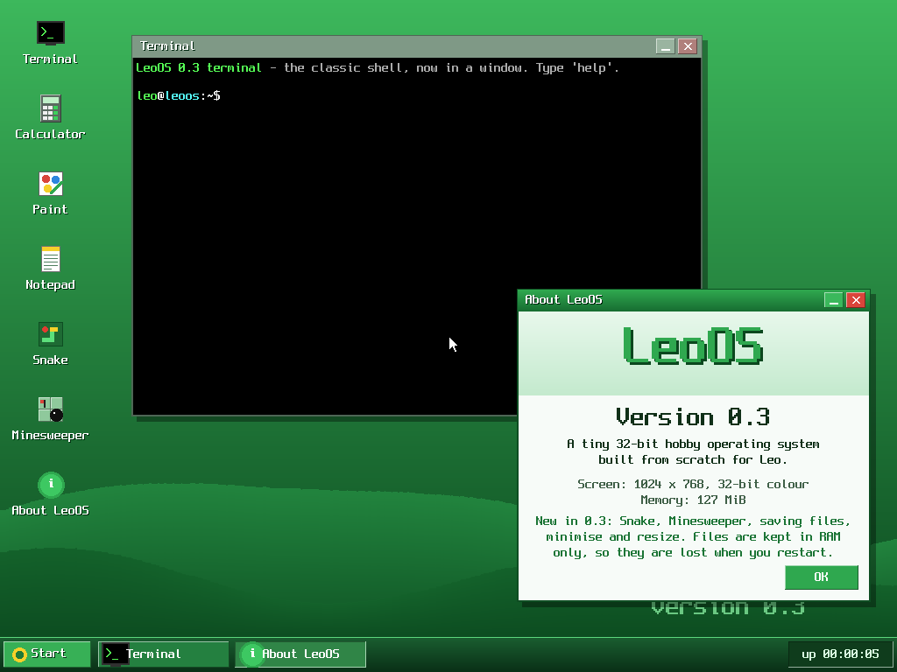

## What's new in 0.3.1 (fixes from Starlink's testing)

- **Resize is easier to grab:** the corner grip is now a bigger green tab. You can grab it from up to 34 px inside the
  corner or 12 px outside it, so a finger or a slightly-off mouse still catches it. The web page also had a bug that let
  the guest cursor drift a few pixels away from the finger over time. It's fixed, so taps now land exactly where you tap
- **Snake no longer ends straight away:** the walls wrap round (go off one side, come back on the other), the snake
  starts in the middle of the board, and the first speed is gentler (0.22 s per step, speeding up as you eat). Only biting
  your own tail ends the game
- **Minesweeper:** New game switches Flag mode back off

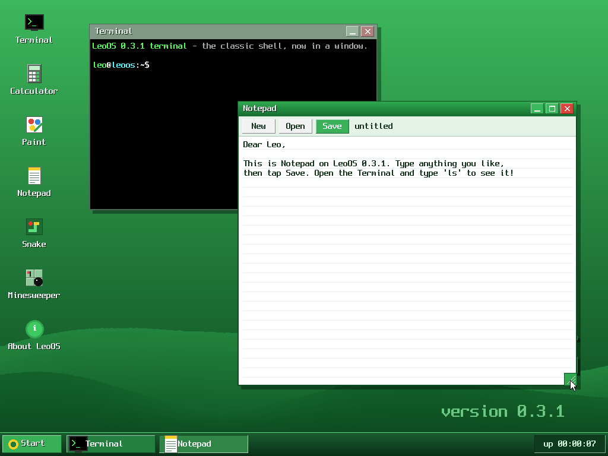

## What's new in 0.3

- **Focus fix:** typing always goes to the window you clicked last. Keyboard and mouse events are now handled in the
  exact order they arrived (each one gets a sequence number in its interrupt handler), so a click followed
  quickly by typing can't send the keys to the old window any more. Clicking anywhere in a window focuses and raises it
- **Minimise:** every window has a minimise button. Minimised windows hide and show as a dark button on the taskbar;
  click it to bring the window back. Clicking the taskbar button of the window you're using minimises it
- **Resize:** drag the grip in the bottom-right corner of Terminal, Paint or Notepad. Paint and Notepad also have a
  maximise button. Notepad re-wraps its text, Paint's canvas grows (up to full screen), and a smaller Terminal shows the
  part around the cursor. Calculator, Snake, Minesweeper and About keep a fixed size
- **Files:** a small RAM filesystem (16 files, up to 4000 bytes each). Notepad has **New**, **Open** and **Save** buttons,
  and the Terminal has `ls`, `cat`, `rm` and `write`. There's no disk driver yet, so **files are lost when you restart**
- **Snake** (walls wrap round since 0.3.1): arrow keys or WASD, or tap the big on-screen arrows (or tap the board on the side you want to turn to),
  so it plays on a phone. The PIT timer moves the snake, and it speeds up as you eat. It keeps your score and best score,
  and has a game-over screen with New game. It pauses when another window is focused
- **Minesweeper** (written by Luna, integrated by Nova): 9x9 with 10 mines, and your first click is never a mine.
  Empty areas open up automatically and the numbers are coloured. It has a mine counter, a smiley **New** button,
  and win and lose banners. Place flags with the **Flag** button (works with taps), the F key or right-click

| | |
|---|---|
| 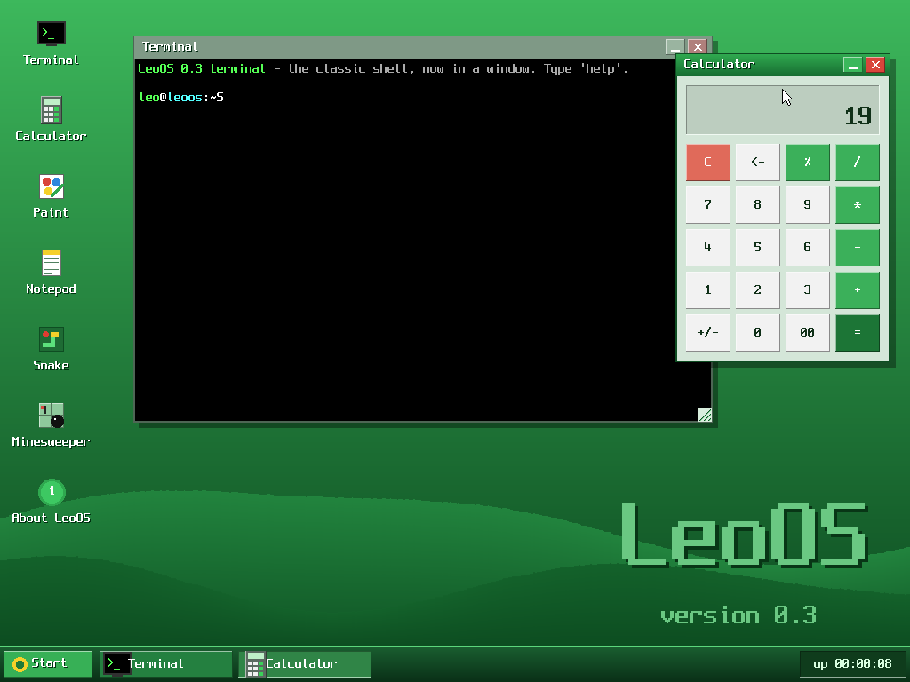 | 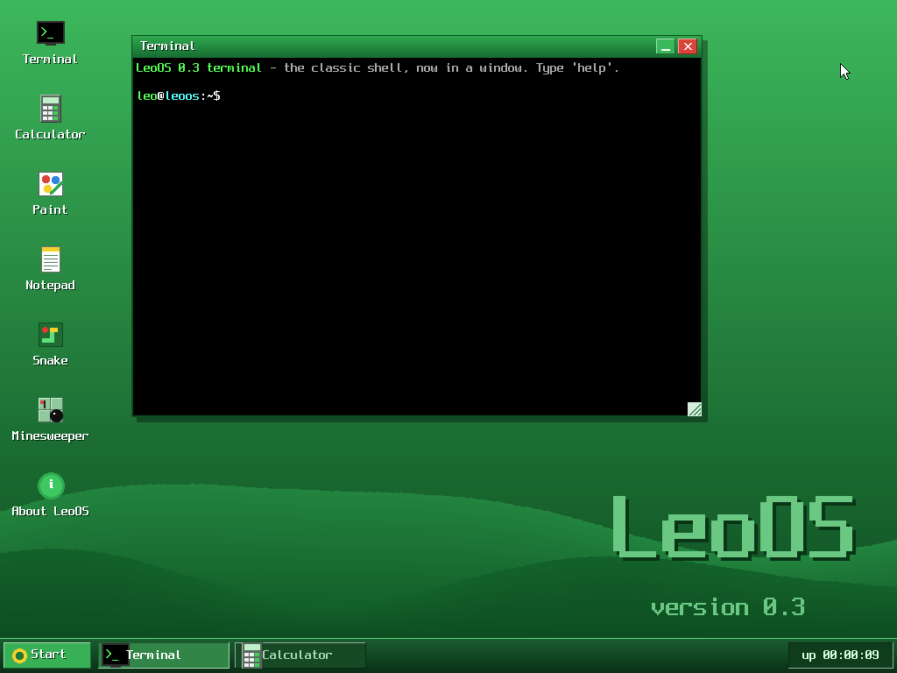 |
| 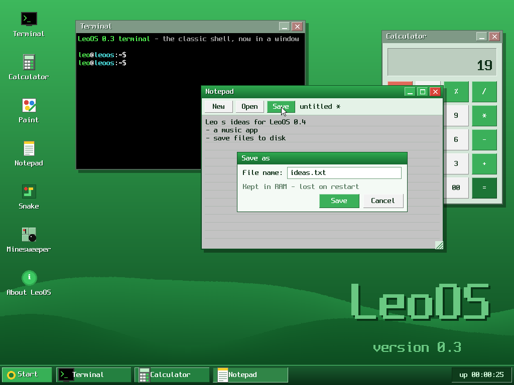 | 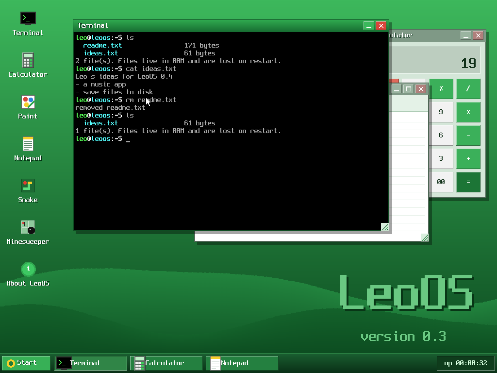 |
| 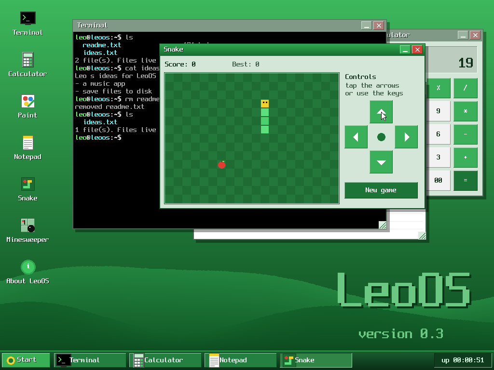 | 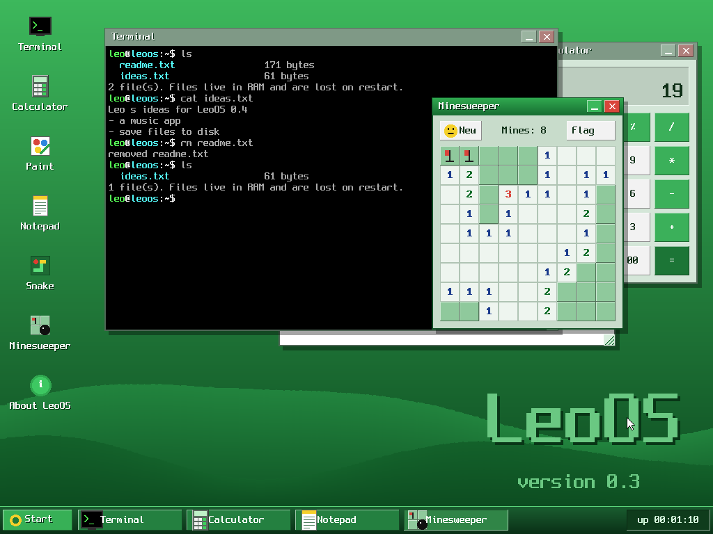 |

`tools/qemu_test.py` drives a headless QEMU through its monitor (clicks, drags, typing and screenshots); it made the screenshots above.

## The desktop (since 0.2)

- **Graphics:** the Multiboot header asks GRUB for a 1024x768, 32-bit linear framebuffer. Everything is drawn
  into a back buffer and copied to the screen in one go (double buffering, so nothing flickers). The wallpaper is
  cached so each frame only redraws windows on top of it
- **Font:** 8x16 bitmap font (Spleen, BSD licence, code page 437 layout, so `£`, `¬` and box characters work)
- **Mouse:** PS/2 driver on IRQ12 with an arrow cursor. Keyboard bytes and mouse bytes are told apart using bit 5 of the controller status
- **Window manager:**
  - windows with a title bar, close button and drop shadow
  - drag a window by its title bar
  - click a window to focus it and bring it to the front
  - the focused window gets the keyboard
- **Taskbar:** a Start button (opens a menu of apps plus Restart and Shut down), one button per open window
  (click it to bring the window forward) and an uptime clock on the right
- **Desktop icons:** click once to open an app
- **Apps:**
  - **Terminal**: the full LeoOS shell running in a window (all the 0.1 commands)
  - **Calculator**: clickable buttons, or type on the keyboard. Handles `+ - * / %`, +/-, backspace and C
  - **Paint**: 12 colours, 3 brush sizes and Clear. Drag to draw
  - **Notepad**: type text with word-wrap and backspace
  - **About LeoOS**: version, screen size and memory
- **Boot menu:** GRUB waits 3 seconds. Pick *LeoOS 0.3 (classic text-mode shell)* to get the original text-mode OS

| | |
|---|---|
| 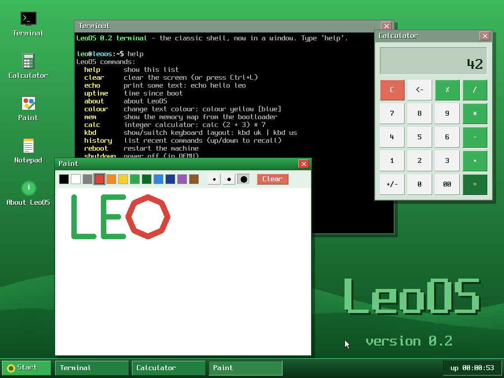 | 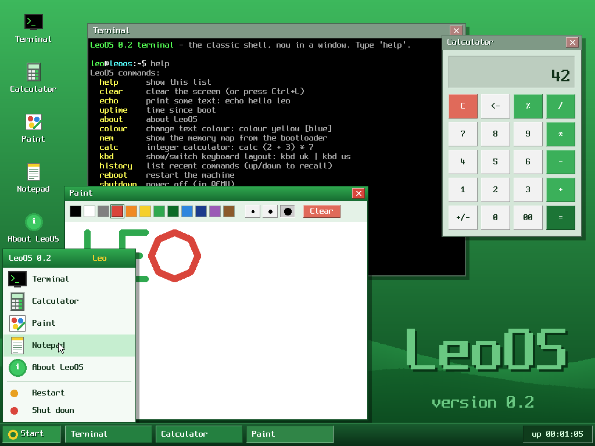 |
| 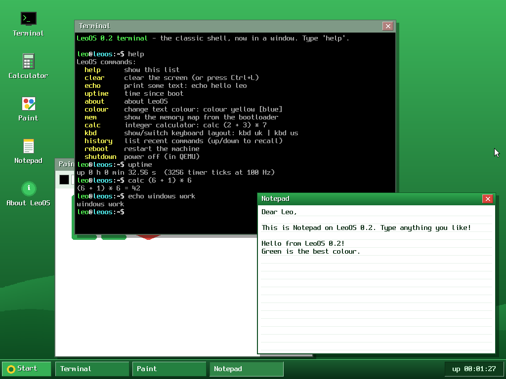 | 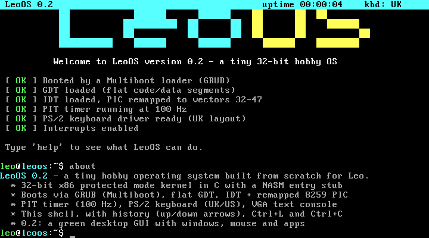 |

## Features (core, since 0.1)

- **Boot:** a Multiboot header that GRUB loads, packaged as a bootable ISO with `grub-mkrescue`
- **CPU setup:** flat GDT, a 256-entry IDT, handlers for the 32 CPU exceptions (panic screen) and the 8259 PIC remapped to vectors 32-47
- **Timer:** 8253/8254 PIT at 100 Hz drives the uptime counter and a live clock in the status bar
- **Keyboard:** PS/2 driver on IRQ1 (scancode set 1). UK layout by default (`" £ @ # ~ ¬ \ |` in the right places), switch to US with `kbd us`. Supports Shift, Caps Lock, Ctrl+L (clear), Ctrl+C (cancel line) and the arrow keys
- **Screen:** VGA text-mode driver (80x25) with 16 colours, scrolling, a hardware cursor, a status bar on the top row and `kprintf`
- **Serial:** everything printed to the screen is also copied to COM1, which helps with debugging (`make run-serial`)
- **Shell:** line editing (backspace), command history (up and down arrows) and these commands:

| Command | What it does |
|---|---|
| `help` | list the commands |
| `clear` | clear the screen |
| `echo <text>` | print text |
| `uptime` | time since boot and timer ticks |
| `about` | about LeoOS |
| `colour <fg> [bg]` / `color` | change text colour, e.g. `colour yellow` or `colour white blue`. Run `colour` alone to list the colours |
| `mem` | memory sizes and the BIOS memory map that GRUB passes in |
| `calc <expr>` | integer calculator with `+ - * / %` and brackets, e.g. `calc (6 + 1) * 6` |
| `kbd [uk\|us]` | show or switch the keyboard layout |
| `ls` | list files (kept in RAM, lost on restart) |
| `cat <file>` | show a file, e.g. `cat readme.txt` |
| `rm <file>` | delete a file |
| `write <file> <text>` | save a line of text to a file, e.g. `write todo.txt feed the snake` |
| `history` | list recent commands |
| `reboot` | restart the machine |
| `shutdown` | power off (works in QEMU, Bochs and VirtualBox) |

## Quick start: just run it

You only need QEMU to run the prebuilt `leo-os.iso`:

```sh
qemu-system-i386 -cdrom leo-os.iso -m 128M
```

| OS | Install QEMU |
|---|---|
| macOS | `brew install qemu` |
| Windows | download the installer from https://www.qemu.org/download/#windows (or `winget install SoftwareFreedomConservancy.QEMU`), then run `"C:\Program Files\qemu\qemu-system-i386.exe" -cdrom leo-os.iso -m 128M` |
| Debian/Ubuntu | `sudo apt install qemu-system-x86` |
| Fedora | `sudo dnf install qemu-system-x86` |
| Arch | `sudo pacman -S qemu-full` |

Click inside the QEMU window to use the mouse and keyboard in LeoOS. To release the mouse, press Ctrl+Alt+G (Ctrl+Option+G on a Mac).
You can also boot the ISO in VirtualBox or VMware as an "Other/Unknown (32-bit)" VM.

## Building from source

### Linux (Debian/Ubuntu)

```sh
sudo apt install build-essential gcc-multilib nasm grub-pc-bin grub-common xorriso mtools qemu-system-x86
make          # builds build/leo-os.bin and leo-os.iso
make run      # boots it in QEMU
make clean
```

On Fedora, install `gcc nasm grub2-tools-extra grub2-pc-modules xorriso mtools qemu-system-x86` and the
host `gcc -m32` support (`glibc-devel.i686 libgcc.i686`). The Makefile picks up `grub2-mkrescue` automatically.

### macOS

Apple's toolchain can't produce ELF kernels, so use a cross compiler:

```sh
brew install i686-elf-gcc i686-elf-grub nasm xorriso qemu make
gmake         # the Makefile uses i686-elf-gcc and i686-elf-grub-mkrescue automatically
gmake run
```

### Windows

Install WSL (`wsl --install -d Ubuntu`) and follow the Linux steps inside it. Then either run
`make run` in WSL (WSLg shows the window) or boot the built `leo-os.iso` with the Windows QEMU.

### Make targets

| Target | Description |
|---|---|
| `make` / `make all` | build both kernels (desktop + text) and `leo-os.iso` |
| `make run` | `qemu-system-i386 -cdrom leo-os.iso -m 128M` |
| `make run-serial` | same as `run`, but the console is also copied to your terminal |
| `make clean` | delete build output |

## Code layout

```
leo-os/
├── Makefile                 build, run and clean targets
├── linker.ld                links the kernel at 1 MiB, Multiboot header first
├── boot/boot.asm            Multiboot header, _start, stack, GDT/IDT load helpers, ISR/IRQ stubs
├── iso/boot/grub/grub.cfg   GRUB menu entry (timeout 0, boots straight into LeoOS)
├── fonts/SPLEEN-LICENSE     licence for the bitmap font
├── include/                 headers: types, port I/O, VGA, CPU/drivers, Multiboot structures
├── kernel/
│   ├── kernel.c             kmain: picks desktop or text mode, brings each subsystem up
│   ├── vga.c                text-mode driver, colours, scrolling, cursor, status bar, kprintf
│   ├── gdt.c                Global Descriptor Table
│   ├── idt.c                IDT, exception panic screen, PIC remap, IRQ dispatch
│   ├── timer.c              PIT at 100 Hz, uptime, sleep, status-bar clock
│   ├── keyboard.c           PS/2 keyboard on IRQ1, UK/US keymaps, key buffer
│   ├── serial.c             COM1 output for debugging
│   ├── shell.c              shell: event-driven line editor, history, commands, calculator
│   ├── gfx.c                framebuffer, back buffer, rectangles, gradients, text, lines, blits
│   ├── font8x16.c           8x16 bitmap font (generated from Spleen)
│   ├── mouse.c              PS/2 mouse on IRQ12
│   ├── gui.c                desktop, window manager, taskbar, Start menu, event loop
│   ├── apps.c               Terminal, Calculator, Paint, Notepad (New/Open/Save), About
│   ├── snake.c              Snake game (0.3)
│   ├── minesweeper.c        Minesweeper game by Luna (0.3)
│   ├── ramfs.c              RAM filesystem used by Notepad and ls/cat/rm/write (0.3)
│   └── string.c             tiny freestanding libc pieces (strlen, memcpy, itoa…)
├── tools/qemu_drive.py      drives a headless QEMU over its monitor (sendkey and screendump)
├── tools/qemu_test.py       the same, plus mouse clicks, right-clicks and drags (0.3)
└── screenshots/             screenshots taken from a real boot in QEMU
```

### How it boots

1. GRUB reads the Multiboot header in `boot.asm`, loads the kernel at 1 MiB in 32-bit protected mode and jumps to `_start`.
2. `_start` sets up a 16 KiB stack and calls `kmain(magic, multiboot_info*)`.
3. `kmain` starts serial and VGA, prints the banner, installs the GDT and IDT, remaps the PIC, starts the PIT and keyboard, then enables interrupts.
4. `shell_run` loops: print the prompt, read a line, look up the command and run it. While waiting for a key the CPU sleeps with `hlt` until the next interrupt.

### How the desktop works

GRUB checks the video fields in the Multiboot header and sets up a 1024x768x32 framebuffer.
`kmain` finds it through the Multiboot info and points the text console at an 80x25 buffer in RAM, which the
Terminal window draws. It then starts the mouse and runs `gui_run`, a loop that:
1. reads keys and mouse packets in the order they arrived
2. updates the windows and lets apps that animate (Snake) step on the timer
3. if anything changed (or the half-second clock tick came round), redraws the whole frame into the back buffer and copies it to the screen

The text-mode menu entry boots `leo-os-text.bin`. That is the same code, built with a header that doesn't ask for graphics.

## Limitations

- Each app has one window
- Files live only in RAM (no disk driver yet), so they are lost on restart. There are no folders, and there's a maximum of 16 files of up to 4000 bytes each
- Calculator works in whole numbers only. Notepad can only add or delete text at the end (there's no cursor movement yet)
- A Terminal window that's smaller than 80x25 shows the part around the cursor instead of re-wrapping lines
- Snake and Minesweeper don't keep high scores after a restart
- The desktop needs a 32-bit colour VBE mode (QEMU, VirtualBox and Bochs have one). If GRUB can't provide it, LeoOS falls back to text mode
- No paging, heap, filesystem, user mode or multitasking yet

## Ideas for 0.3

A RAM-disk filesystem so Notepad can save, a heap allocator, resizable windows, a Snake or Minesweeper game,
a CMOS real-time clock in the taskbar.

## Screenshots from 0.1 (text mode)

| | |
|---|---|
| 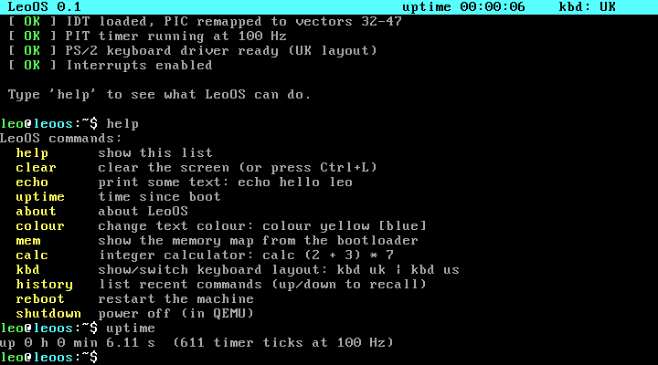 | 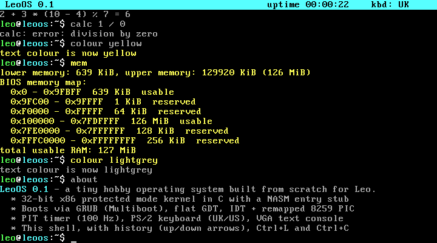 |
| 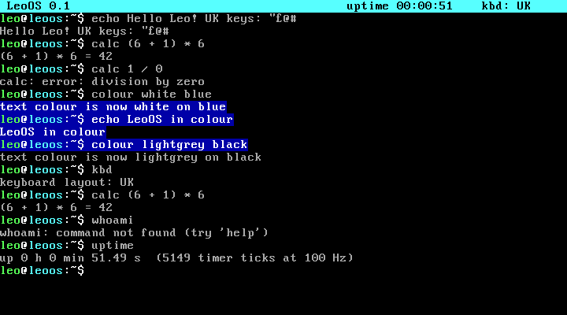 | 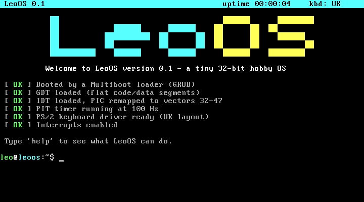 |
